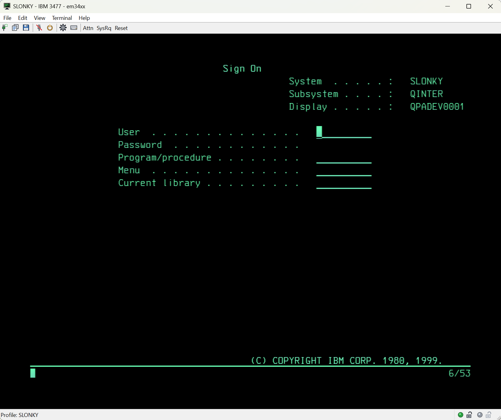

# em34xx

An emulator for IBM 34xx 5250 Twinax terminals that runs the terminal's own
firmware. It connects to an IBM i host over TN5250.



## Download

Windows builds (`em34xxw.exe`, Windows 7 and later) and macOS builds
(`em34xx.app`, macOS 11 and later, Apple silicon and Intel) are on the
[releases page](https://github.com/cyberdotgent/em34xx/releases).

## ROMs

ROM images are not included. Dump them from your own terminal. On first
start, em34xxw or em34xx.app asks for them and checks them by SHA-256; the
expected files are listed in [roms/ROMS.md](roms/ROMS.md). The emulator
contains no code or data from the ROMs.

## Using em34xxw

- **File > New Connection** connects to a host. **File > Connect to
  Profile** opens a saved profile.
- A profile holds the terminal type, the CRT type and up to two sessions,
  each with or without TLS. **Edit > Connection Settings** changes the
  running profile.
- The toolbar has Disconnect/Reconnect, Reboot, Attn, SysRq, Reset and Setup.
- The status bar shows each session's state and TLS lock.

Settings, ROMs, profiles and the keymap live in `%APPDATA%\em34xx`. More in
[docs/frontend-win32.md](docs/frontend-win32.md).

On macOS, em34xx.app works the same with Mac conventions: Command
shortcuts, Settings in the app menu, and a window per terminal (every
profile you open gets its own window; several run side by side). Its
files live in `~/Library/Application Support/em34xx`; Mac keyboards have
no Right Ctrl, so the key labelled *enter* (fn+Return on laptops) is the
5250 Enter. More in [docs/frontend-cocoa.md](docs/frontend-cocoa.md).

## Building

You need CMake 3.21 or later, Ninja, a C++17 compiler and
[vcpkg](https://vcpkg.io). TLS uses the system OpenSSL on Linux, SChannel
on Windows and Network.framework on macOS.

```sh
export VCPKG_ROOT=~/vcpkg
cmake --preset release && cmake --build --preset release
```

Windows binaries are cross-built on Linux with MinGW-w64:

```sh
cmake --preset mingw-x64-release && cmake --build --preset mingw-x64-release
```

Use `mingw-x86-release` for 32-bit.

On a Mac, `macos-release` builds everything, em34xx.app included, as
universal binaries (arm64 + x86_64); `release` builds for the Mac's own
architecture only:

```sh
cmake --preset macos-release && cmake --build --preset macos-release
```

Programs:

| Program | What it is |
| --- | --- |
| `em34xxw` | the Windows GUI |
| `em34xx.app` | the macOS GUI |
| `em34xx` | SDL3 window with a debug monitor and GDB stub |
| `em34xx-headless` | the same without a window |
| `tn5250-probe` | stand-alone TN5250 client for testing |

Run the tests with `ctest --preset release -LE slow`. The full CPU test
suite needs `tools/fetch-test-vectors.sh`.

## Developer tools

`em34xx` and `em34xx-headless` have a monitor (breakpoints, stepping,
memory, scripts) and a GDB stub. See [docs/monitor.md](docs/monitor.md),
[docs/architecture.md](docs/architecture.md),
[docs/twinax-bridge.md](docs/twinax-bridge.md) and
[docs/tn5250.md](docs/tn5250.md).

## Licence

GPL-3.0-or-later; see [LICENSE](LICENSE). Third-party notices are shown in
em34xxw's Help > About and in em34xx.app's About em34xx.
